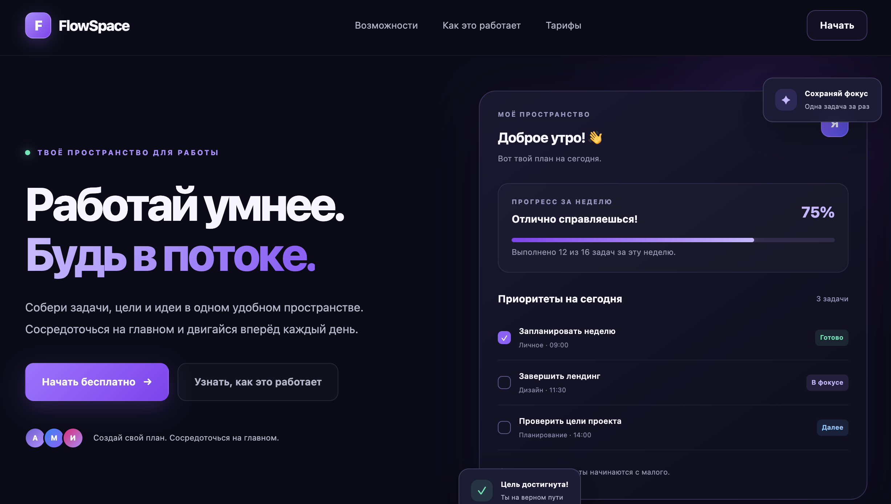

# FlowSpace — SaaS Landing Page

Концептуальный лендинг для сервиса управления задачами и продуктивностью.

## 🚀 Демо

[Открыть FlowSpace](https://igritsenko1991-collab.github.io/flowspace-landing/)

## 📌 О проекте

FlowSpace — учебный frontend-проект в современном SaaS-стиле. Дизайн сочетает тёмный фон, фиолетовые градиенты и адаптивные блоки интерфейса.

## 🛠 Технологии

- HTML5
- CSS3
- JavaScript
- Responsive Design
- Intersection Observer API
- Git и GitHub Pages

## ✨ Возможности

- Адаптивная навигация с мобильным меню
- Плавная прокрутка между секциями
- Анимация появления элементов при прокрутке
- Карточки тарифов с демонстрационными обработчиками кнопок
- Поддержка настройки уменьшения анимации
- Актуальный год в футере

## 📱 Адаптивность

Интерфейс разработан с учётом отображения на настольных компьютерах, планшетах и мобильных устройствах.

## 👨‍💻 Автор

Игорь Гриценко

- GitHub: [igritsenko1991-collab](https://github.com/igritsenko1991-collab)